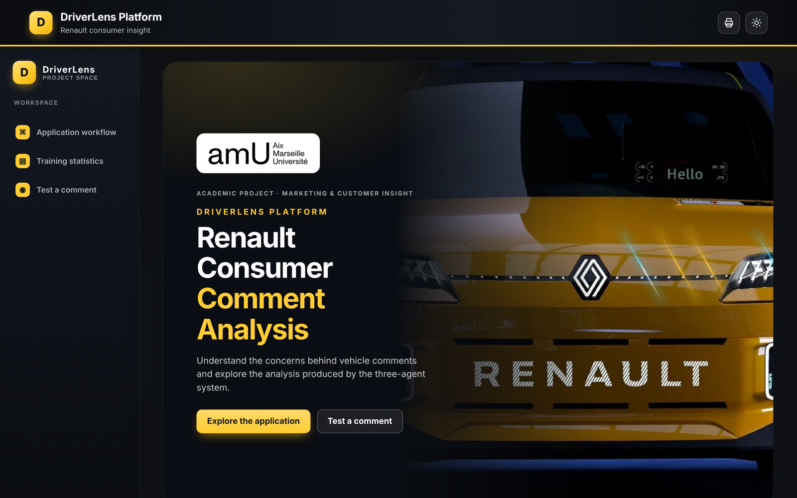
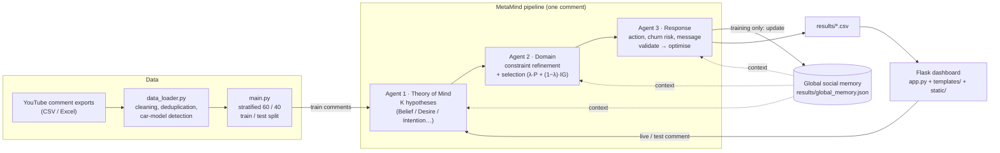
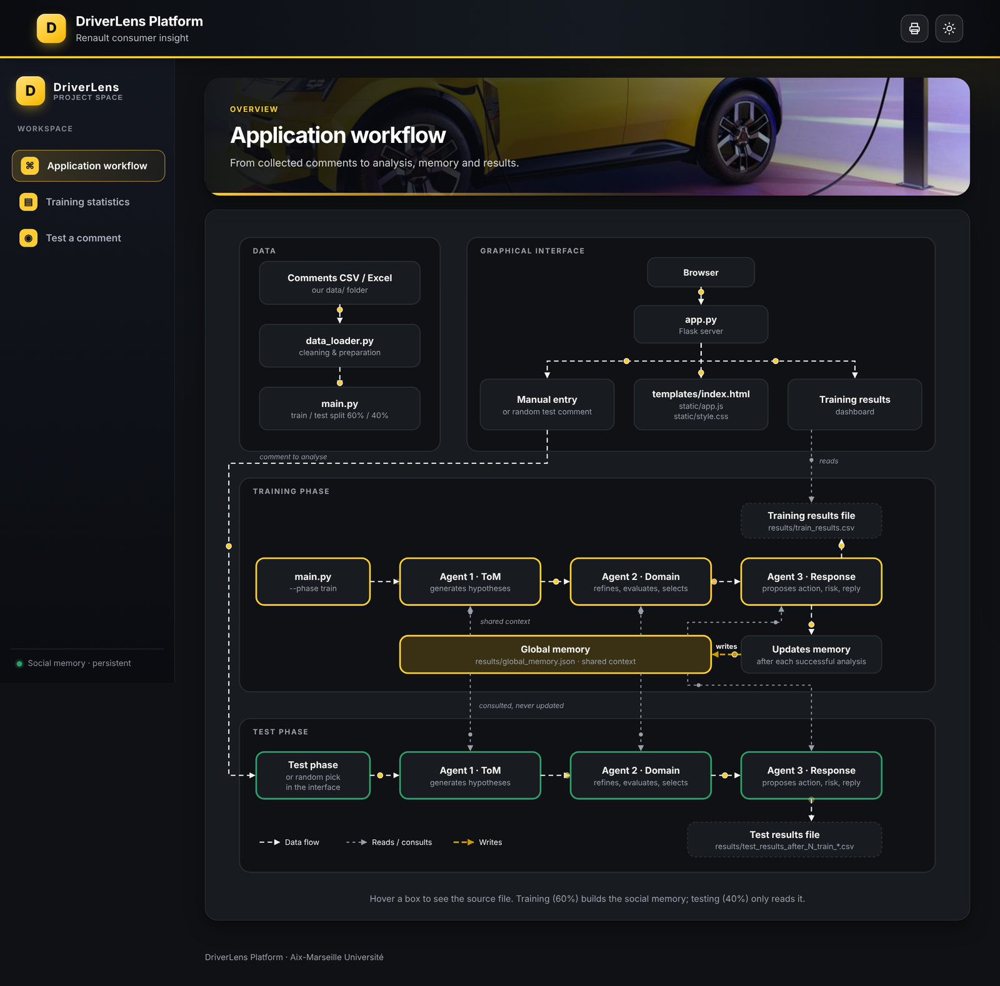
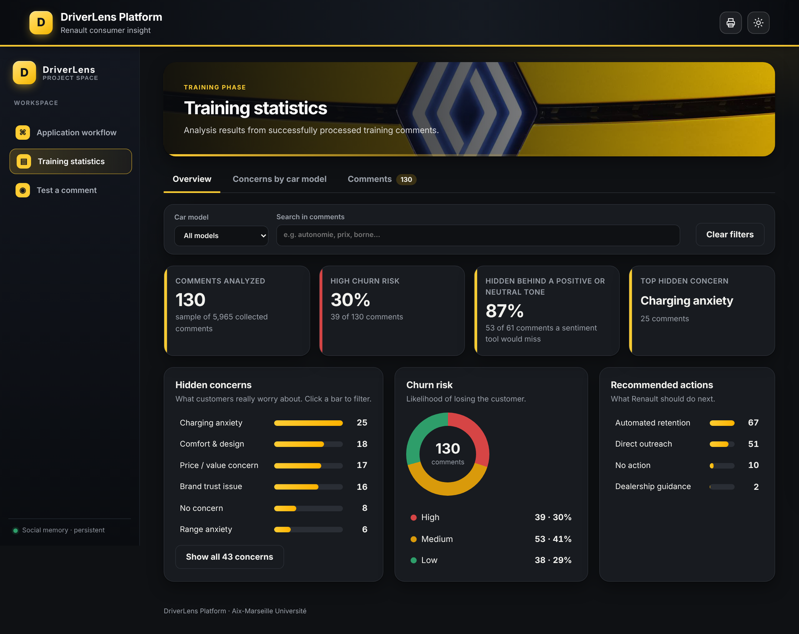
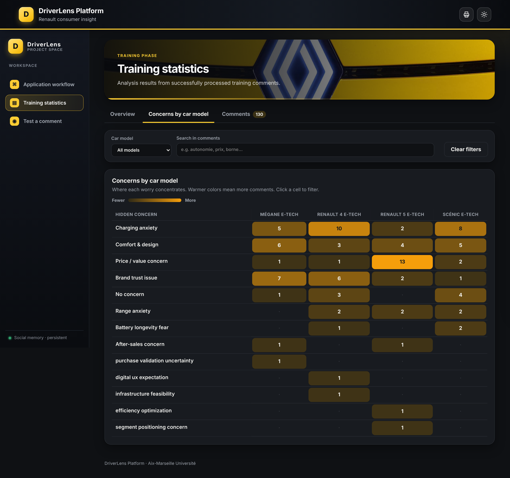
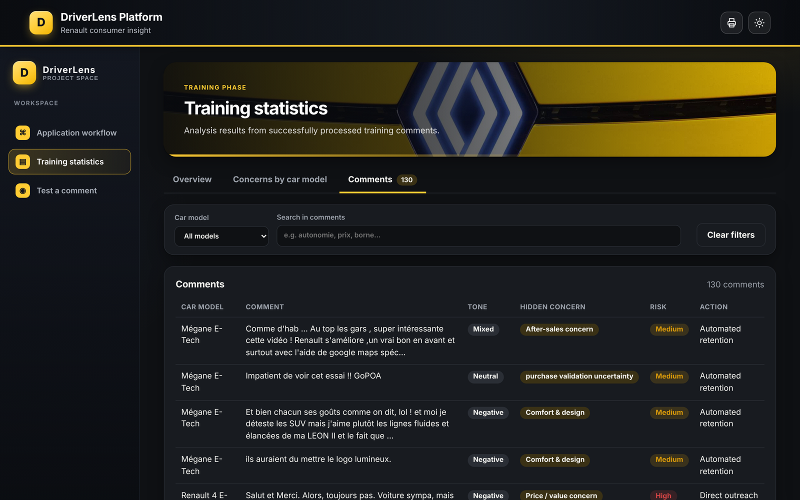
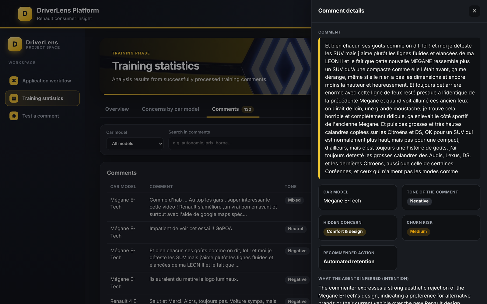
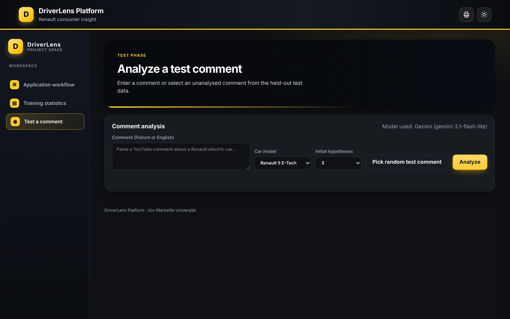
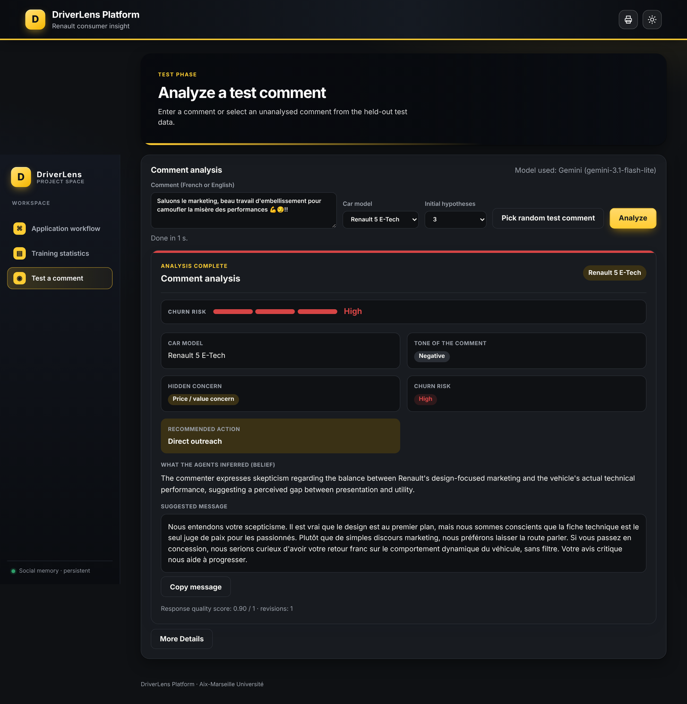

<div align="center">

# DriverLens Platform
### Reading between the lines of customer comments: a MetaMind-based multi-agent system for Renault electric vehicles


*Academic project, Master 2, Aix-Marseille Université*



</div>

---

## Table of contents

1. [Problem statement](#1-problem-statement)
2. [Our solution](#2-our-solution)
3. [Scientific approach: the MetaMind framework](#3-scientific-approach-the-metamind-framework)
4. [Architecture, modules and agents](#4-architecture-modules-and-agents)
5. [Data: source and nature](#5-data-source-and-nature)
6. [The application: screenshots](#6-the-application-screenshots)
7. [Results](#7-results)
8. [Installation and usage](#8-installation-and-usage)
9. [Configuration](#9-configuration)
10. [Repository structure](#10-repository-structure)
11. [Limitations and future work](#11-limitations-and-future-work)
12. [Reference](#12-reference)
13. [Authors and acknowledgements](#13-authors-and-acknowledgements)

---

## 1. Problem statement

The electric-vehicle (EV) market is moving fast, and buyers talk openly about cars online: under YouTube reviews, test drives and launch videos. For a carmaker, these comments are a **free, spontaneous and continuous source of customer insight**. They are also very hard to use:

- **What is said is not what is meant.** French-speaking commenters often express dissatisfaction through **irony, understatement or sarcasm**. *"Nice marketing work to hide how poor the performance is 💪😏"* reads as praise to a keyword-based tool.
- **Classic sentiment analysis stops at the surface.** It labels a comment *positive / negative / neutral* but cannot say **why** the customer hesitates (range? charging? price? brand trust?) or **what to do about it**.
- **Volume.** Thousands of comments per model make manual reading impossible for marketing, customer-experience or retention teams.
- **Constraints.** Any automated answer must respect French consumer law (no misleading claims on range, charging time or price), the **GDPR** (no profiling of the author) and basic ethics (no pressure on emotionally vulnerable customers).

> **Research question:** *Can a large language model, guided by a cognitively inspired multi-agent architecture, infer the hidden concern behind a customer comment and turn it into an appropriate, compliant business action?*

## 2. Our solution

**DriverLens** is an end-to-end platform that reads YouTube comments about Renault's electric range (**Renault 5 E-Tech, Renault 4 E-Tech, Mégane E-Tech, Scénic E-Tech**) and, for each comment, produces a decision-ready insight:

| Output | Meaning |
|---|---|
| **Surface sentiment** | The tone a basic sentiment tool would see (positive / negative / neutral / mixed) |
| **Hidden (latent) concern** | What the customer really worries about: range anxiety, charging anxiety, battery longevity, price/value, brand trust, after-sales, comfort/design, or no concern |
| **Mental-state hypothesis** | A short explanation of the commenter's belief, desire or intention, with supporting evidence |
| **Churn risk** | Likelihood of losing the (prospective) customer: low / medium / high |
| **Recommended action** | `AUTOMATED_RETENTION`, `DEALERSHIP_GUIDANCE`, `DIRECT_OUTREACH` or `NO_ACTION` |
| **Suggested message** | A personalised, empathetic and compliant reply, written in the language of the comment |
| **Quality score** | Utility score of the reply (empathy × coherence), with the number of self-revisions |

Results are aggregated in an **interactive dashboard** for decision makers (hidden concerns, churn risk, actions, concern × car-model heat map, searchable comment table) and any new comment can be **analysed live**, with a full trace of how the three agents reached their conclusion.

**Key insight delivered:** in our training sample, **87 % of the comments whose tone looked positive or neutral still hid a real concern** (53 of 61): comments that a standard sentiment tool would have classified as "no problem".

## 3. Scientific approach: the MetaMind framework

The platform is an adaptation of **MetaMind** (Zhang et al., *NeurIPS 2025*), a multi-agent framework inspired by the psychological theory of **metacognition** and **Theory of Mind (ToM)**, the human ability to attribute unobservable mental states (beliefs, desires, intentions, emotions) to others. MetaMind decomposes social understanding into three collaborative stages:

1. A **Theory-of-Mind Agent** generates several hypotheses about the user's mental state.
2. A **Moral (Domain) Agent** refines these hypotheses under cultural, ethical and role constraints, then selects the best one.
3. A **Response Agent** generates a response and validates it against the inferred intent, revising it if necessary.

A **social memory** feeds the three stages with what has been learned from previous interactions.

### How we adapted MetaMind to customer-insight analytics

| MetaMind (original paper) | DriverLens (this project) |
|---|---|
| A user utterance in a dialogue | A YouTube comment + its context (car model, parent comment, likes) |
| Generic mental states | Mental states **mapped to an automotive taxonomy of latent concerns** (range, charging, battery, price, brand trust, after-sales, comfort/design) |
| Generic social norms | **French-market rules**: irony and understatement, FR/EN code-switching, consumer law (no misleading claims), GDPR data minimisation, no exploitation of vulnerability |
| Free-text response | A **business action** + churn risk + reply message |
| Per-user social memory | A **global, aggregated memory** built only from the training split (no author profiling, GDPR by design) |
| OpenAI models | **Google Gemini / Gemma** through the `google-genai` SDK, with rate limiting and retries for the free tier |

### Hypothesis selection (Domain Agent)

Following the paper, each refined hypothesis $\tilde h_i$ is scored by balancing **contextual plausibility** and **information gain**:

$$
\text{score}_i = \lambda \, P(\tilde h_i \mid u_t, C_t, M_t) + (1-\lambda)\,\Big[\log P(\tilde h_i \mid u_t, C_t, M_t) - \log P(\tilde h_i)\Big]
$$

where $u_t$ is the comment, $C_t$ its context, $M_t$ the social memory and $P(\tilde h_i)$ the prior plausibility of the same concern in EV comments in general. The information-gain term rewards hypotheses that are **specific to this comment** rather than generic. Non-compliant hypotheses are discarded. Default: $\lambda = 0.6$.

### Response validation (Response Agent)

$$
U = \beta \cdot \text{Empathy} + (1-\beta)\cdot \text{Coherence}, \qquad \beta = 0.8
$$

If $U < 0.8$ (or if the reply is judged non-compliant, which caps $U$ at 0.5), the agent critiques and rewrites its own reply, up to **2 revisions**.

## 4. Architecture, modules and agents



**Training phase** (60 % of comments): every successful analysis is written to `results/train_results.csv` and **updates the global memory**.
**Test phase** (40 % held-out comments): the same pipeline runs with the memory **read-only**; each training snapshot gets its own test result file.

### 4.1 Agents (`agents/`)

| Agent | File | Role | LLM calls per comment |
|---|---|---|---|
| **BaseAgent** | `base_agent.py` | Shared helpers: prompt formatting, context building, robust key-value parsing, score extraction | — |
| **Theory-of-Mind Agent** | `tom_agent.py` | Generates *K* diverse hypotheses (cycling through Belief, Desire, Intention…) on the commenter's hidden mental state, each with a latent concern, a surface sentiment and textual evidence. Separates opinions about the *video* from opinions about the *car*. | *K* (default 3) |
| **Domain Agent** | `domain_agent.py` | Checks every hypothesis against cultural, ethical, regulatory and role rules for the French market, revises it, then selects the best one with the plausibility + information-gain score. | 2*K* + priors (cached) |
| **Response Agent** | `response_agent.py` | Chooses the retention action and the churn risk, writes the reply, scores it (empathy, coherence, compliance) and self-revises while utility < threshold. | 2 to 6 |

### 4.2 Other modules

| Module | Content |
|---|---|
| `prompts/prompt_templates.py` | All prompts of the three agents, with strict output formats parsed by the agents |
| `memory/social_memory.py` | Persistent **global** memory: per-model summaries of sentiments, recurring concerns and churn risk, injected as context into every prompt. Atomic saves, schema versioning |
| `llm_interface/` | `BaseLLM` contract (`generate(prompt) -> str`), `GeminiLLM` (Google GenAI SDK with throttling, exponential back-off and retries on 429/5xx) and `MockLLM` (fake model to test the wiring without an API key) |
| `utils/data_loader.py` | Reads heterogeneous CSV/Excel exports, harmonises column names through aliases, cleans HTML/URLs/invisible characters, removes `@mentions`, emoji-only and duplicate comments, detects the car model, assigns stable comment IDs |
| `utils/helpers.py` | Logging and tolerant JSON parsing |
| `main.py` | Command-line pipeline: stratified per-model split saved in `results/split_manifest.json`, resumable training, test phase, memory rebuild from results |
| `app.py` + `templates/` + `static/` | Flask web application: dashboard, workflow diagram, live analysis in a background thread with progress polling, agent-trace viewer, light/dark theme, print to PDF |
| `config.py` | Every tunable parameter (paths, LLM, agents, split, batch size) |
| `test_models.py`, `test_llm.py`, `test_data.py` | Utilities: list the Gemini models available with your key, check the API connection, inspect what the loader understood |

## 5. Data: source and nature

| | |
|---|---|
| **Source** | Public **YouTube comments** posted under French-language videos (reviews, test drives, presentations) about Renault electric cars, collected with a browser-based comment export tool |
| **Files** | 12 exports (2 CSV, 10 Excel), one per video; two different export layouts harmonised automatically |
| **Raw volume** | 6,051 rows → **5,965 comments** after cleaning (65 empty/too short/emoji-only rows and 21 duplicates removed) |
| **Car models** | Renault 5 E-Tech (2,362) · Mégane E-Tech (1,680) · Scénic E-Tech (1,299) · Renault 4 E-Tech (624) |
| **Language** | Mainly French, with some English and mixed FR/EN, automotive slang (*autonomie, borne, recharge rapide, wallbox*), irony and emojis |
| **Period** | Comments published between October 2024 and October 2026 (where an absolute date is available) |
| **Fields used** | Comment text, likes, publication date, parent comment (for replies), car model. Author fields are read but **never sent to the LLM nor stored in the memory** |
| **Nature** | Unstructured, short user-generated text (median length 121 characters, max 1,000), **unlabelled**: no ground truth for concerns or churn |
| **Split** | Stratified per car model, seed 42: **3,578 training** (60 %) / **2,387 test** (40 %) comments |

> **Privacy.** The raw exports contain personal data (author names, channel IDs, avatar URLs) and are therefore **not published** in this repository (see [`our data/README.md`](our%20data/README.md)). The published result files contain only comment text, model outputs and hashed comment IDs.

## 6. The application: screenshots

Launch it with `python app.py` and open <http://127.0.0.1:5000>.

### Application workflow
An interactive diagram of the whole pipeline, from data files to agents, memory and results.



### Training statistics: overview
Key figures, hidden concerns, churn-risk distribution and recommended actions, all filterable by car model or keyword.



### Concerns by car model
A heat map showing where each concern concentrates; clicking a cell filters the comments.



### Analysed comments and details
Every analysed comment with its tone, hidden concern, risk and action; a side panel shows the agents' inference and the suggested reply.

<table>
<tr>
<td width="50%"></td>
<td width="50%"></td>
</tr>
</table>

### Test phase: analysing a held-out comment
Write a comment, or pick a random **unseen** test comment, choose the number of initial hypotheses (2 to 5) and run the three agents. The result below is the actual Gemini output saved for a held-out Renault 5 E-Tech comment (`results/test_results_after_120_train_f16ebb34de.csv`).

<table>
<tr>
<td width="50%"></td>
<td width="50%"></td>
</tr>
</table>

Here an ironic comment (*"Saluons le marketing, beau travail d'embellissement pour camoufler la misère des performances 💪😏!!"*) is correctly read as **sarcasm hiding a price/value concern**, classified as **high churn risk**, and answered with a **direct outreach** message that acknowledges the criticism without making unverifiable claims (utility 0.90 after one self-revision).

## 7. Results

> All figures below come from the files in [`results/`](results/), produced with **Gemini `gemini-3.1-flash-lite`**, *K* = 3 hypotheses per comment.

### 7.1 Training run

| Metric | Value |
|---|---|
| Training comments processed | 140 (stratified sample of the 3,578-comment training split) |
| Successful analyses | **130** (10 API errors: quota, empty responses, server errors) |
| Comments per model | R4: 34 · R5: 34 · Mégane: 33 · Scénic: 29 |
| Mean response utility | **0.87** (median 0.90) |
| Replies accepted without revision | 90 (69 %) · 1 revision: 27 · 2 revisions: 13 |
| Hidden concern behind a positive/neutral tone | **87 %** (53 / 61) |

**Surface sentiment:** negative 56 · neutral 39 · positive 22 · mixed 13.
**Churn risk:** high 39 (30 %) · medium 53 (41 %) · low 38 (29 %).
**Recommended actions:** automated retention 67 · direct outreach 51 · no action 10 · dealership guidance 2.

**Top hidden concerns:** charging anxiety (25) · comfort & design (18) · price/value (17) · brand trust (16) · no concern (8) · range anxiety (6) · battery longevity (3) · after-sales (2).

### 7.2 Insights per car model

| Car model | Dominant hidden concerns | High churn risk |
|---|---|---|
| **Renault 5 E-Tech** | Price / value (13 of 34), comfort & design (4) | 17 / 34 (50 %) |
| **Renault 4 E-Tech** | Charging anxiety (10 of 34), brand trust (6) | 18 / 34 (53 %) |
| **Mégane E-Tech** | Brand trust (7 of 33), comfort & design (6), charging (5) | 4 / 33 (12 %) |
| **Scénic E-Tech** | Charging anxiety (8 of 29), comfort & design (5) | 0 / 29 (0 %) |

**Business reading.** The **Renault 5** debate is about **price versus perceived value**, while the **Renault 4** audience worries mostly about **charging** and is the most at risk. **Mégane** comments question **brand trust and design choices**, and the **Scénic** is the best-received model (no high-risk comment, more "no concern" cases).

### 7.3 Test phase

The global memory was evaluated on held-out comments at four training snapshots (after 19, 60, 116 and 120 training comments, 14 test comments in total, `results/test_results_after_*.csv`). All test analyses completed without error, with utility scores between **0.82 and 0.98**.

> **Note on evaluation.** The data is **unlabelled**, so these figures describe the system's outputs and its self-assessed reply quality; they are **not** accuracy measures against human annotation (see [Limitations](#11-limitations-and-future-work)).

## 8. Installation and usage

### Prerequisites
- Python **3.10+**
- A free **Google AI Studio** API key (<https://aistudio.google.com/apikey>) for real analyses. Not needed for demo mode.

### Install

```bash
git clone https://github.com/<your-username>/MetaMind-DriverLens.git
cd MetaMind-DriverLens

python -m venv .venv
source .venv/bin/activate          # Windows: .venv\Scripts\activate
pip install -r requirements.txt

cp .env.example .env               # then put your GEMINI_API_KEY in .env
```

Place your comment exports in `our data/` (see [`our data/README.md`](our%20data/README.md)).

### Run the pipeline (command line)

```bash
python test_models.py                       # optional: find a Gemini model ID that works with your key
python main.py --phase train --dry-run      # check the wiring with the fake model (no API key, no cost)
python main.py --phase train                # analyse a batch of training comments (resumable)
python main.py --phase train --n 50         # choose the batch size
python main.py --phase test                 # analyse one held-out comment per car model
```

A stopped run can be restarted: completed comments are skipped and the split is never redrawn.

### Run the dashboard

```bash
python app.py              # uses Gemini if a key is set, otherwise the demo model
python app.py --mock       # force the fake model (instant, meaningless answers)
python app.py --port 8000
```

Then open <http://127.0.0.1:5000>.

## 9. Configuration

All parameters are in [`config.py`](config.py); secrets live in `.env`.

| Parameter | Default | Description |
|---|---|---|
| `GEMINI_MODEL` (`.env`) | `gemini-3.8-flash` in code; the published results used `gemini-3.1-flash-lite` | Model ID |
| `GEMINI_THINKING_LEVEL` (`.env`) | `low` | `low` / `medium` / `high`, or `none` for models without thinking (Gemma) |
| `MIN_INTERVAL_SECONDS` (`.env`) | `4` | Pause between API calls (free-tier rate limits) |
| `TOM_CONFIG.hypothesis_count_k` | `3` | Number of ToM hypotheses per comment |
| `DOMAIN_CONFIG.lambda_weight` | `0.6` | Plausibility vs information-gain trade-off |
| `RESPONSE_CONFIG.beta` | `0.8` | Empathy vs coherence weight in utility |
| `RESPONSE_CONFIG.utility_threshold` | `0.8` | Below this, the reply is revised |
| `RESPONSE_CONFIG.max_revisions` | `2` | Maximum self-revisions |
| `RUN_CONFIG.sample_size` | `20` | Training comments per run |
| `RUN_CONFIG.train_fraction` | `0.6` | Train / test ratio |
| `RUN_CONFIG.random_seed` | `42` | Reproducibility of the split and sampling |

The French-market rules of the Domain Agent can be replaced through `DOMAIN_CONFIG["domain_rules"]`, and the concern taxonomy through `TOM_CONFIG["latent_concerns"]`.

## 10. Repository structure

```text
MetaMind-DriverLens/
├── agents/
│   ├── base_agent.py          # shared helpers
│   ├── tom_agent.py           # Agent 1 · Theory of Mind
│   ├── domain_agent.py        # Agent 2 · Domain (moral & cultural)
│   └── response_agent.py      # Agent 3 · Response
├── llm_interface/
│   ├── base_llm.py            # LLM contract
│   ├── gemini_llm.py          # Google Gemini client (throttling, retries)
│   └── mock_llm.py            # fake model for dry runs
├── memory/
│   └── social_memory.py       # global social memory
├── prompts/
│   └── prompt_templates.py    # prompts of the three agents
├── utils/
│   ├── data_loader.py         # loading, cleaning, model detection
│   └── helpers.py
├── templates/index.html       # dashboard (Flask/Jinja)
├── static/                    # app.js, style.css, images
├── our data/                  # raw exports (git-ignored, see README inside)
├── results/                   # published results
│   ├── train_results.csv
│   ├── test_results_after_*_train_*.csv
│   ├── global_memory.json
│   └── split_manifest.json
├── docs/screenshots/          # screenshots used in this README
├── main.py                    # CLI pipeline (train / test)
├── app.py                     # web dashboard
├── config.py                  # all settings
├── test_models.py · test_llm.py · test_data.py
├── requirements.txt
├── .env.example
└── .gitignore
```

## 11. Limitations and future work

- **No ground truth.** Comments are unlabelled; a manually annotated sample (concern, sentiment, churn) is needed to measure accuracy, precision/recall and inter-annotator agreement, and to compare with a classic sentiment baseline.
- **LLM self-evaluation.** Utility scores are produced by the same model family that writes the replies; an independent evaluator or human rating would make them more reliable.
- **Taxonomy drift.** The model sometimes creates concern labels outside the predefined list (≈ 35 rare labels in training); constraining the output or mapping labels back to the taxonomy would make statistics cleaner.
- **Sample size and cost.** 130 analysed training comments out of 3,578, limited by free-tier API quotas (≈ 10–15 LLM calls per comment).
- **Single source.** YouTube only; forums, social networks, dealer reviews and app-store reviews would broaden the picture.
- **Next steps:** batch processing, label normalisation, human-in-the-loop validation of messages, CRM integration of the recommended actions, time-series tracking of concerns after product updates.

## 12. Reference

This project implements and adapts the framework described in:

> Xuanming Zhang, Yuxuan Chen, Samuel Yeh, Sharon Li. **MetaMind: Modeling Human Social Thoughts with Metacognitive Multi-Agent Systems.** *Advances in Neural Information Processing Systems (NeurIPS 2025)*, Spotlight. arXiv:2505.18943.
> Paper: <https://arxiv.org/abs/2505.18943> · Official code: <https://github.com/XMZhangAI/MetaMind>

```bibtex
@inproceedings{zhang2025metamind,
  title     = {MetaMind: Modeling Human Social Thoughts with Metacognitive Multi-Agent Systems},
  author    = {Zhang, Xuanming and Chen, Yuxuan and Yeh, Samuel and Li, Sharon},
  booktitle = {Advances in Neural Information Processing Systems},
  year      = {2025},
  url       = {https://arxiv.org/abs/2505.18943}
}
```

## 13. Authors and acknowledgements

Academic project carried out at **Aix-Marseille Université** (Master 2).

- **Meriem AROUR**
- *Add the other team members here*

Thanks to the authors of MetaMind for releasing their framework. Renault, the Renault logo and the vehicle names are trademarks of Renault Group; the vehicle images in `static/` are used for illustration only in this non-commercial academic project. This project is not affiliated with or endorsed by Renault Group.
